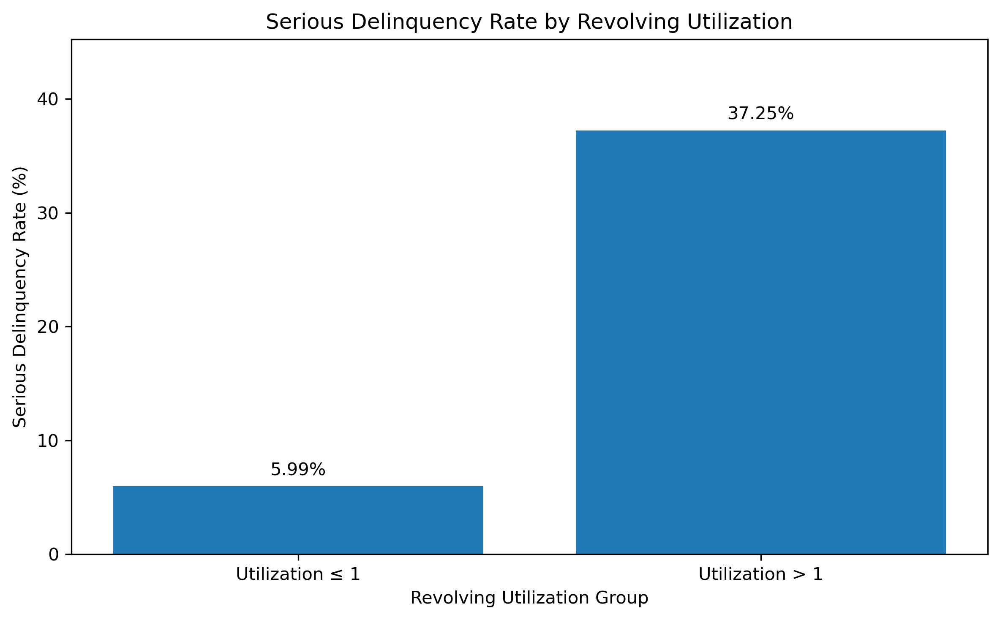
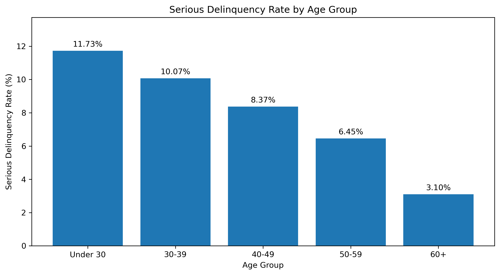
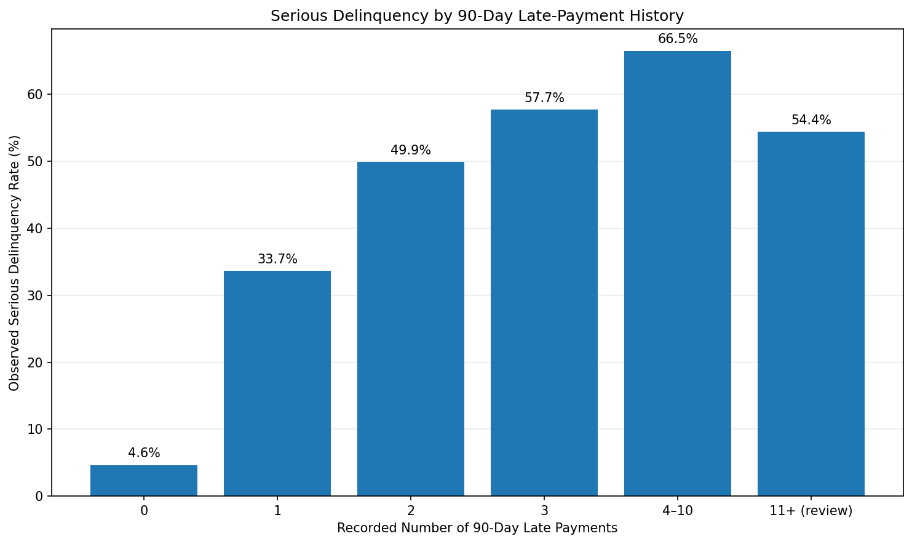
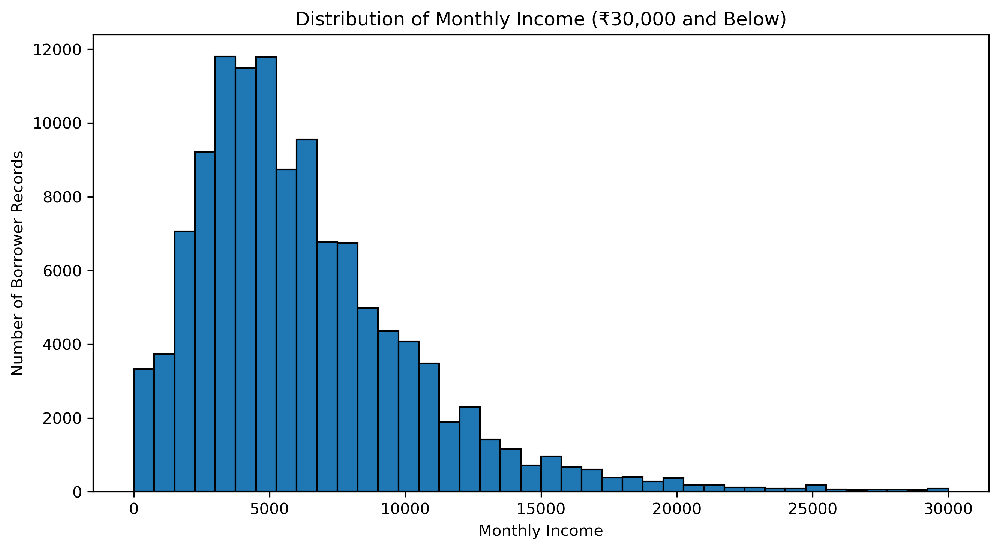
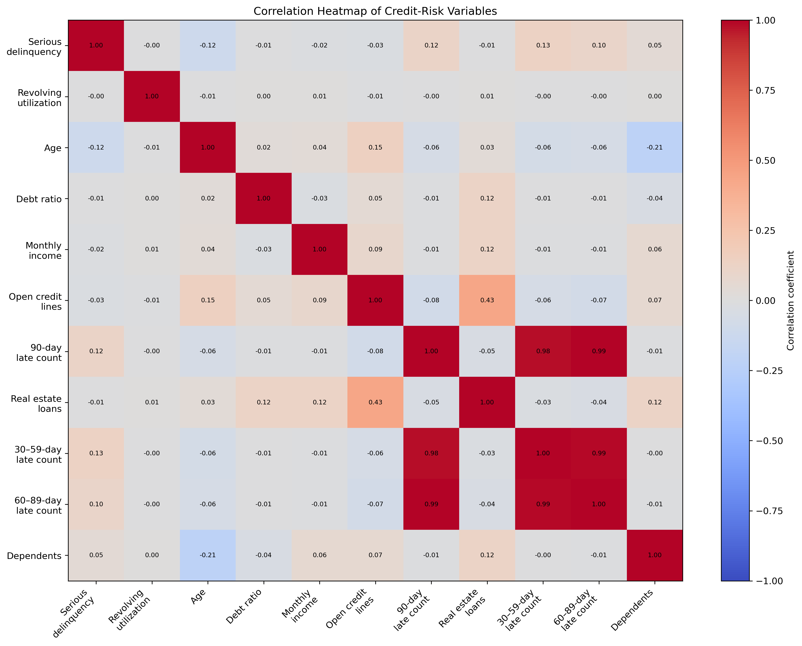

# Credit Risk Exploratory Data Analysis & Data Quality Audit

## 1. Project Overview

This project explores borrower characteristics, repayment behaviour, and data-quality issues using the **Give Me Some Credit** dataset.

Built with Python, pandas, NumPy, and Matplotlib, the project follows a practical credit-risk analytics workflow: understanding the data, identifying potential quality issues, comparing serious delinquency rates across borrower segments, and translating the results into meaningful business observations.

The objective is not simply to analyse numerical patterns, but also to understand the limitations of the underlying data before drawing conclusions.

## 2. Business Objective

The project investigates two key questions:

1. How do borrower characteristics and recorded repayment-history indicators differ between borrowers with and without a serious delinquency indicator?
2. What data-quality issues should be investigated before these variables are used in further credit-risk analysis?

The analysis focuses on exploratory data analysis (EDA), data-quality validation, borrower segmentation, visualisation, and responsible interpretation of results.

## 3. Dataset

The project uses the **Give Me Some Credit** dataset, originally published for a Kaggle competition.

- **Source:** [Kaggle — Give Me Some Credit](https://www.kaggle.com/c/GiveMeSomeCredit/data)
- **Dataset size:** 150,000 records and 12 columns
- **Target variable:** `SeriousDlqin2yrs`
- **Target interpretation:** `1` indicates a serious delinquency event under the dataset's definition; `0` indicates no recorded event of that type.

The accompanying data dictionary is used to understand the variables and support the interpretation of findings.

### Important data considerations

The dataset contains missing values, extreme ratio values, unusual observations, and delinquency counts that require further investigation. These observations are assessed as part of the data-quality audit rather than automatically treated as confirmed errors.

The raw dataset is kept locally and is not intended to be redistributed through this repository. Obtain it from the original source and follow the applicable terms.

## 4. Tools & Technologies

| Tool | Purpose |
|---|---|
| Python | Analysis and workflow automation |
| Jupyter Notebook | Interactive analysis and documentation |
| pandas | Data manipulation, aggregation, and data-quality checks |
| NumPy | Numerical operations |
| Matplotlib | Data visualisation |
| Git | Version control |
| GitHub | Project publishing and portfolio presentation |

## 5. Analytical Approach

The project follows a structured exploratory data analysis workflow.

1. **Dataset setup and documentation** — Organise the source files and document their origin.
2. **Data understanding** — Examine the dataset's structure, data types, distributions, and summary statistics.
3. **Data-quality audit** — Investigate missing values, unusual observations, extreme values, and exact duplicate rows.
4. **Feature preparation** — Apply filters and create derived flags to support segment-level analysis.
5. **Risk segmentation** — Compare observed serious delinquency rates across age groups, revolving-utilisation groups, debt-ratio groups, and repayment-history indicators.
6. **Visualisation** — Use charts to explore distributions, relationships, and differences between borrower segments.
7. **Validation and interpretation** — Cross-check calculations and document findings, limitations, and areas requiring further investigation.

## 6. Key Findings

### 6.1 Overall serious delinquency

Of the 150,000 records, **10,026** have `SeriousDlqin2yrs = 1`, representing approximately **6.68%** of the dataset.

This is the observed proportion for the dataset's target variable. It should not be interpreted as a forecast of future defaults or as a current credit portfolio default rate.

### 6.2 Revolving credit utilisation

Records with revolving utilisation above 1 have an observed serious delinquency rate of approximately **37.25%**, compared with **5.99%** for records with utilisation at or below 1.

This difference makes revolving utilisation a useful area for further investigation. However, the threshold above 1 is an exploratory segmentation choice, not a validated lending-policy cutoff.

### 6.3 Age-group patterns

The observed serious delinquency rate declines across the age groups used in the analysis:

- **Under 30:** 11.73%
- **Age 60 and above:** 3.10%

This is a descriptive pattern. Further investigation would be needed to understand how other borrower characteristics, data-quality issues, and potential confounding factors may influence the relationship.

### 6.4 Missing income data

Monthly income is missing for **29,731 records (19.82%)**.

Missingness differs across the target groups:

- Records with `SeriousDlqin2yrs = 0`: approximately **20.05%** have missing monthly income.
- Records with `SeriousDlqin2yrs = 1`: approximately **16.65%** have missing monthly income.

This reinforces the importance of examining missingness before relying on income-based comparisons. Missing income should not automatically be interpreted as zero income.

### 6.5 Debt-ratio observations

A total of **35,137 records (23.42%)** have a debt ratio above 1.

A debt ratio above 1 may warrant investigation, but it does not automatically indicate an error. Interpretation depends on the variable definition, denominator, and underlying financial context.

The analysis also identified a substantial association between debt ratios above 1 and missing monthly income. This is an important data-quality observation to investigate before conducting income-dependent analysis.

### 6.6 Unusual delinquency counts

The audit identified **264 records** with a value of 98 across all three delinquency-count columns.

These records warrant further investigation because the repeated pattern may influence summary statistics and correlations. The value is flagged for review rather than assumed to represent a confirmed data error or a documented special code.

### 6.7 Duplicate records

The audit identified **zero exact duplicate rows** in the dataset.

This result applies to exact row-level duplication. It does not establish that every record represents a unique borrower or that no other forms of duplication exist.

## 7. Selected Visualisations

The following charts highlight selected patterns explored during the analysis. They are descriptive visualisations and should be interpreted alongside the data-quality findings and methodology.

### Serious delinquency by revolving utilisation



This chart compares the observed serious delinquency rate between records with revolving utilisation at or below 1 and records above 1.

### Serious delinquency by age



This chart shows how observed serious delinquency rates vary across the age groups defined in the analysis.

### Serious delinquency by 90-day late-payment history



This chart explores the relationship between recorded 90-day late-payment counts and the serious delinquency indicator.

### Monthly income distribution



This focused view helps examine the distribution of recorded monthly income while limiting the displayed range to improve readability. It does not represent the full income distribution.

### Credit-risk correlation heatmap



This heatmap provides an exploratory view of relationships among selected numerical variables. Correlations do not establish causation, and unusual repeated values may influence the results.

## 8. Data-Quality Audit Summary

The audit focuses on identifying observations that may require additional review before the dataset is used for further analysis.

| Data-quality check | Finding | Interpretation |
|---|---|---|
| Dataset dimensions | 150,000 records, 12 columns | Confirms the expected dataset size |
| Target prevalence | 10,026 positive records (6.68%) | Descriptive proportion of the target |
| Missing monthly income | 29,731 records (19.82%) | Material missingness requiring consideration |
| Missing dependents | 3,924 records (2.62%) | Missing values requiring assessment |
| Exact duplicate rows | 0 | No exact row duplicates identified |
| Age anomalies | Values include 0 and values above 100 | Requires validation against the data definition |
| Revolving utilisation | Values above 1, including extreme values | Requires contextual review; not automatically invalid |
| Debt ratio | 35,137 records above 1 | Requires interpretation based on the variable definition |
| Repeated delinquency value | 264 records have 98 in all three delinquency-count columns | Requires further investigation |

These checks support a disciplined approach to data-quality assessment. A flagged observation is not automatically a confirmed data error, and any decision to correct, exclude, or transform data should be documented and justified.

## 9. Project Structure

The project is organised as follows:

```text
credit-risk-eda/
├── README.md
├── requirements.txt
├── .gitignore
├── data/
│   ├── cs-training.csv
│   ├── Data Dictionary.xls
│   └── README.txt
├── notebooks/
│   └── credit_risk_eda.ipynb
└── outputs/
    └── charts/
        ├── serious_delinquency_by_age.png
        ├── serious_delinquency_by_utilization.png
        ├── serious_delinquency_by_90day_lates.png
        ├── serious_delinquency_by_debt_ratio.png
        ├── serious_delinquency_segment_comparison.png
        ├── monthly_income_distribution_under_30000.png
        ├── monthly_income_by_delinquency_boxplot.png
        ├── credit_risk_correlation_heatmap.png
        └── monthly_income_vs_debt_ratio_focused.png
```

The notebook contains the analysis, while `outputs/charts/` stores the exported visualisations.

The `data/` directory is intended for local source files. Raw dataset files are excluded from Git by default through `.gitignore`; therefore, users cloning the repository may need to obtain the dataset separately.

## 10. Reproducing the Analysis

Follow these steps to reproduce the analysis locally.

### Step 1: Obtain the project

Clone the repository after it has been published on GitHub, or download the project files.

### Step 2: Obtain the dataset

Download the required dataset from the [Kaggle Give Me Some Credit page](https://www.kaggle.com/c/GiveMeSomeCredit/data), subject to its applicable terms.

Place the required CSV file at:

```text
credit-risk-eda/data/cs-training.csv
```

Ensure the accompanying data dictionary is available locally if you intend to consult it.

### Step 3: Set up Python

Install a compatible Python environment and Jupyter Notebook.

### Step 4: Install dependencies

From the project root, run:

```bash
pip install -r requirements.txt
```

### Step 5: Open the notebook

Open `notebooks/credit_risk_eda.ipynb` in Jupyter Notebook.

The notebook currently uses a relative dataset path and expects to run with the `notebooks/` directory as its working directory. If your environment uses a different working directory, adjust the path configuration accordingly.

### Step 6: Run the analysis

Restart the notebook kernel and run all cells from beginning to end.

Review the outputs, charts, and findings to confirm that the analysis completes successfully.

## 11. Limitations & Next Steps

- This project is an exploratory analysis, not a validated credit-risk model.
- Observed relationships do not establish causation.
- Missing values and extreme observations may affect statistical summaries and visualisations.
- Segmentation thresholds are exploratory and should not be treated as lending rules.
- Unusual values require verification before any correction or exclusion.
- No predictive model has been trained or evaluated as part of this project.
- The analysis does not establish that the observed relationships will generalise to another population or a current lending portfolio.

Potential next steps include deeper missing-data analysis, validation of unusual observations against authoritative definitions, and further investigation of how borrower characteristics interact with recorded repayment behaviour.

## 12. Conclusion

This project demonstrates a practical approach to exploring credit-risk data, auditing data quality, comparing borrower segments, and communicating findings with appropriate caution.

It combines data inspection, numerical analysis, visualisation, and business interpretation to show how an analyst can identify potentially meaningful patterns without overstating the evidence.

**A key principle of risk analytics is that meaningful conclusions depend not only on the analysis itself, but also on the quality of the underlying data and the discipline used to interpret it.**
